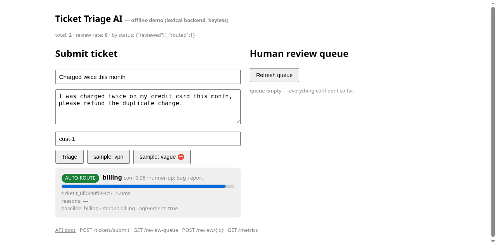
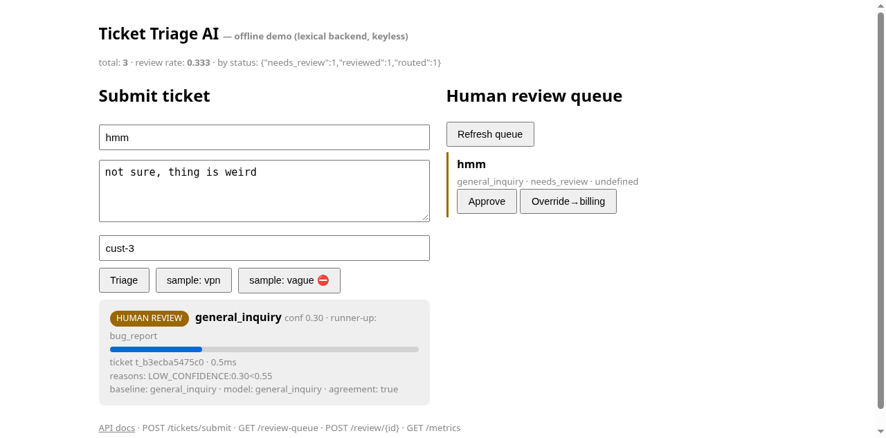

# Ticket Triage AI — confidence-gated support ticket routing

Support ticket classifier that auto-routes only when confident and sends everything uncertain, risky, or contested to a human review queue.

   

🚀 **[Try the live demo — no install](https://tiagoccepp.github.io/ticket-triage-ai/?demo=1)** — pre-recorded real triage, loads in seconds.




## The problem

Naive ticket classifiers either auto-route everything (misroutes erode trust) or dump raw model output with no calibration. This project answers: how do you add a category without retraining? How do you stop hallucinated labels from reaching production? When should the model abstain instead of guessing?

## 60-second run

```bash
git clone https://github.com/tiagoccepp/ticket-triage-ai && cd ticket-triage-ai
pip install -r requirements.txt
./demo.sh   # API on :8002, keyless offline mode — then open /ui
```

```bash
curl -X POST localhost:8002/tickets/submit -H 'Content-Type: application/json' \
  -d '{"title":"Double charge","body":"I was charged twice, please refund."}'
curl localhost:8002/review-queue   # human review queue
curl localhost:8002/metrics        # accuracy-on-routed + review rate
```

## Stack

| Layer | Choice |
|---|---|
| API | FastAPI + Pydantic v2 |
| DB | SQLite default, Postgres via `DATABASE_URL` |
| LLM | OpenAI-compatible HTTP (stdlib, no SDK), keyless mock fallback |
| Offline backend | Pure-Python TF-IDF, zero deps |
| Evals | `eval/run_evals.py` over 80 golden tickets |

## How it works

- **Taxonomy-as-data** (`src/taxonomy.py`) — add a label by editing data, zero retraining.
- **Validity gate in code** — any label outside the taxonomy → confidence 0 + abstain.
- **HybridPolicy** (`src/hybrid.py`) — deterministic baseline × model cross-check; `HIGH_SEVERITY` / `LOW_CONFIDENCE` / `DISAGREEMENT` / `ABSTENTION` all route to humans.
- **Duplicate detection** via TF-IDF cosine; **append-only audit trail** for every triage + review.

Headline metric: **accuracy-on-routed = 1.000** (lexical backend, 80 golden tickets) at a 0.487 review rate. Reproduce: `python eval/run_evals.py --backend lexical`.

## Repo map

```
src/   config, taxonomy, baseline, classifier, hybrid, db, api, evals
tests/ 41 offline tests (pytest, no API key)
eval/  golden_tickets.jsonl (80) + run_evals.py
docs/  ARCHITECTURE deep dive, methodology, live-verification notes
```

## Tests & evals

```bash
pytest -q                            # 41 offline tests
python eval/run_evals.py --backend lexical
```

## License

MIT — see `LICENSE`. *(Note: add an MIT `LICENSE` file to the repo; the original README claims MIT but no license file is currently present.)*
