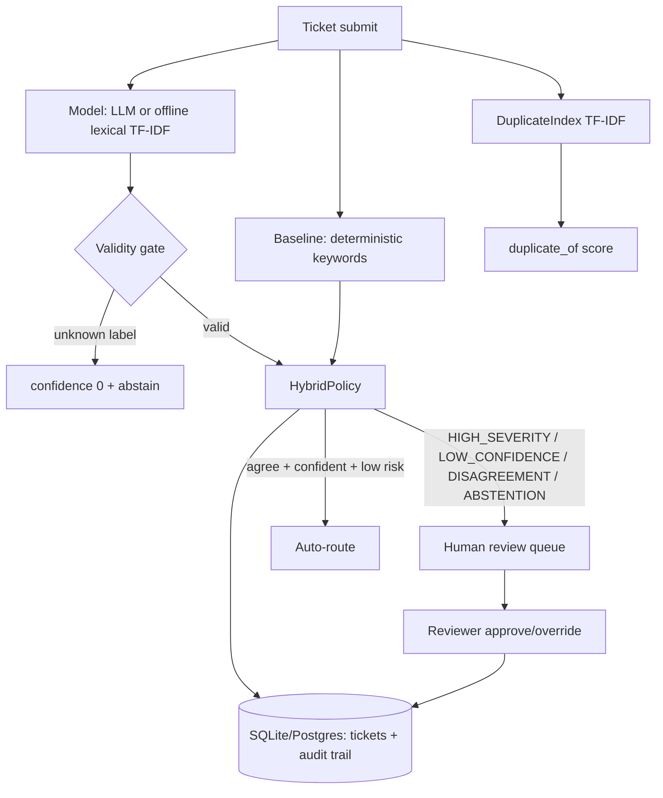

# Ticket Triage AI

Production-grade MVP that classifies support tickets with **confidence-gated automation**: high-confidence predictions auto-route, everything uncertain, risky, or contested goes to a human review queue. Abstention is a first-class outcome — the system says "I don't know" instead of guessing.

Built with modern 2026 patterns: taxonomy-as-data (no retraining to add a label), code-enforced validity gate, runner-up calibration, hybrid baseline+LLM policy, duplicate detection, and a persisted audit trail. Fully offline-capable: CI runs keyless on the lexical backend.

> Developed with AI pair-programming workflows (Claude Code / Cursor style): spec-driven file layout, test-first backends, eval-gated thresholds.

## Problem

Support teams drown in untriaged tickets. Naive classifiers either auto-route everything (misroutes erode trust) or surface raw model output with no calibration. This project answers:

- How do you add a category without retraining?
- How do you stop hallucinated labels from reaching production?
- When should the model abstain instead of guessing?
- How do you know the automation is safe? (accuracy-**on-routed**, not raw accuracy)

## Architecture



## Stack

| Layer | Choice |
|---|---|
| Language | Python 3.11+ (stdlib-first where possible) |
| API | FastAPI + Pydantic v2 |
| DB | SQLite default, Postgres via `DATABASE_URL` |
| LLM | OpenAI-compatible HTTP (stdlib, no SDK) with keyless mock fallback |
| Offline backend | Pure-Python TF-IDF (zero deps) |
| Tests | pytest (offline, no keys) |
| Evals | `eval/run_evals.py` over 80 golden tickets |

## Quickstart

```bash
cd /home/tito/projects/ticket-triage-ai
python3 -m venv .venv && source .venv/bin/activate  # or: uv venv && source .venv/bin/activate
pip install -r requirements.txt
cp .env.example .env   # optional; defaults are offline-safe

# Run the API
uvicorn src.api:app --reload --port 8000

# Submit a ticket
curl -X POST localhost:8000/tickets/submit \
  -H 'Content-Type: application/json' \
  -d '{"title":"Double charge","body":"I was charged twice, please refund."}'

# Human review queue
curl localhost:8000/review-queue

# Review a ticket
curl -X POST localhost:8000/review/<ticket_id> \
  -H 'Content-Type: application/json' \
  -d '{"decision":"approve","reviewer":"ana"}'

# Metrics + health
curl localhost:8000/metrics
curl localhost:8000/health
```

### Run tests + evals

```bash
pytest -q            # 30+ offline tests, no API key
python eval/run_evals.py --backend lexical
python eval/run_evals.py --backend mock
```

## Metrics (lexical backend, 80 golden tickets)

| Metric | Lexical backend | Mock-LLM backend |
|---|---|---|
| Accuracy-on-routed | **1.000** | **1.000** |
| Overall accuracy | 0.912 | 0.900 |
| Review rate | 0.487 | 0.487 |
| Disagreement rate | 0.188 | 0.188 |
| Latency p50 / p95 | 0.13 / 0.14 ms | 0.24 / 0.36 ms |

Reproduce: `python eval/run_evals.py --backend lexical` (80 golden tickets, offline).

The headline metric is **accuracy-on-routed**: of the tickets the system auto-routed (no human), how many were right? Review rate is the cost of that safety. Tune `AUTO_THRESHOLD` / `REVIEW_THRESHOLD` in `.env` against these evals.

## Review queue UI (API description)

There is no frontend in this MVP; the review queue is a JSON API designed for a thin UI:

- `GET /review-queue` — tickets with status `needs_review`/`abstained`, newest first. Each includes `label`, `confidence`, `runner_up`, `duplicate_of`, plus the full audit trail via `GET /tickets/{id}`.
- `POST /review/{id}` — `{"decision":"approve"|"override","label":"...","reviewer":"...","notes":"..."}`. Overrides validate against the taxonomy server-side.
- A minimal reviewer UI renders: ticket text, predicted label + confidence bar, runner-up, routing reasons (`DISAGREEMENT`, `HIGH_SEVERITY`, …), suspected duplicate, one-click Approve / label picker + Override.

## Key design decisions

1. **Taxonomy-as-data** (`src/taxonomy.py`): labels, keywords, severities, SLA, examples in one module; prompt rendering derives from it. Add a label = edit data, zero retraining.
2. **Validity gate in code** (`validity_gate`): any label outside the taxonomy → confidence 0 + abstain. Prompt instructions are advisory; the gate is law.
3. **Runner-up everywhere**: every prediction carries second-best + confidence for calibration and reviewer context.
4. **HybridPolicy** (`src/hybrid.py`): deterministic baseline × model cross-check; `HIGH_SEVERITY`, `LOW_CONFIDENCE`, `DISAGREEMENT`, `ABSTENTION` all route to humans.
5. **Duplicates via TF-IDF** (`DuplicateIndex`): cosine over TF-IDF vectors today; swap in embedding vectors behind the same interface later.
6. **Audit trail**: every triage + review is an append-only event with full model/baseline/policy payload for postmortems.

## Project layout

```
src/            config, taxonomy, baseline, classifier, hybrid, db, api, evals
tests/          5 files, 30+ offline tests
eval/           golden_tickets.jsonl (80) + run_evals.py
data/           sample_tickets.json
ARCHITECTURE.md deep dive · METHODOLOGY.md / docs/methodology.md calibration method
```

## License

MIT (MVP scaffold — adapt freely).
